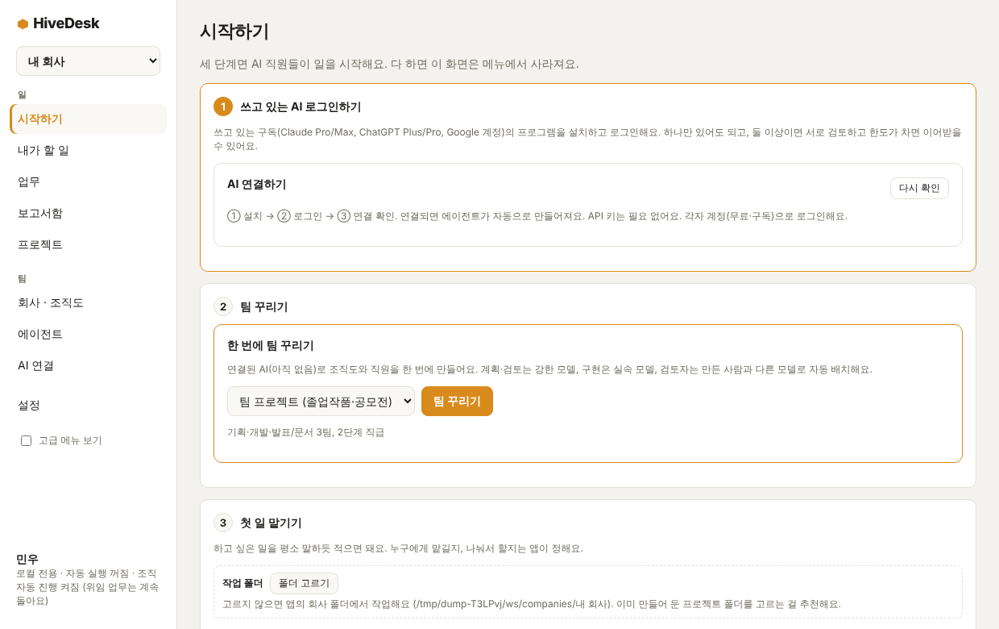
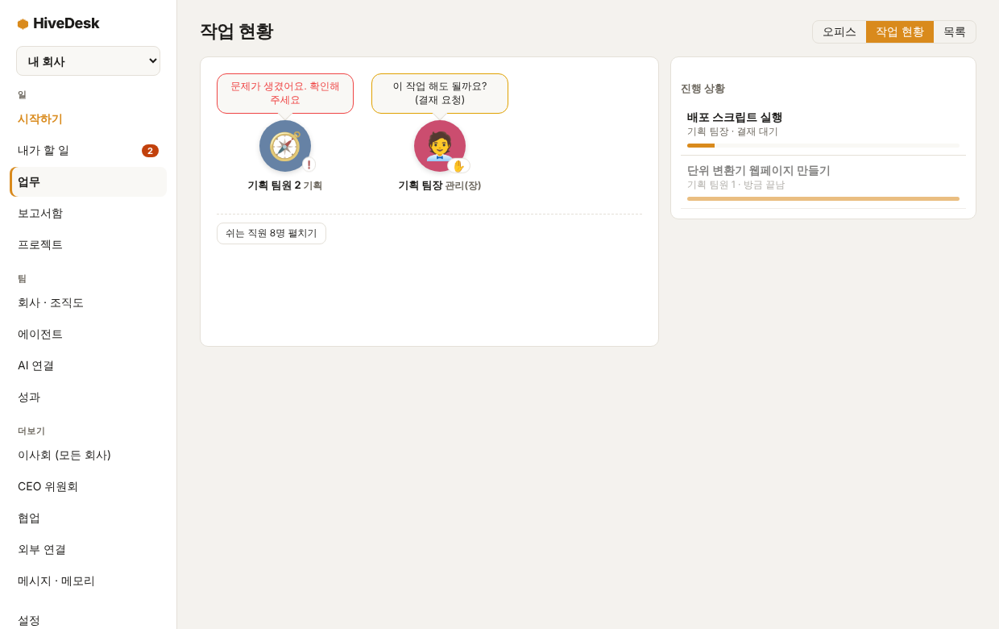
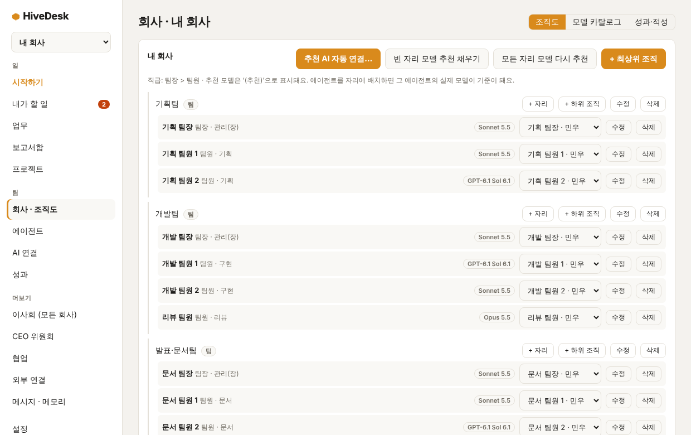
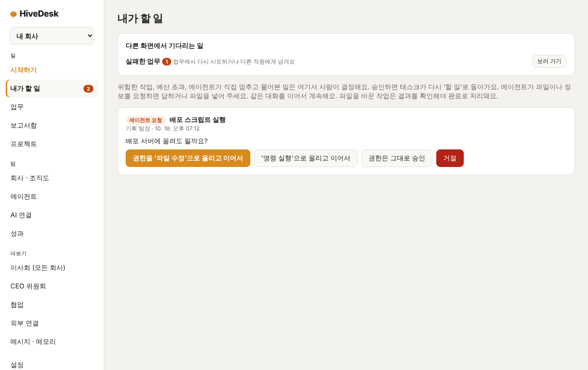
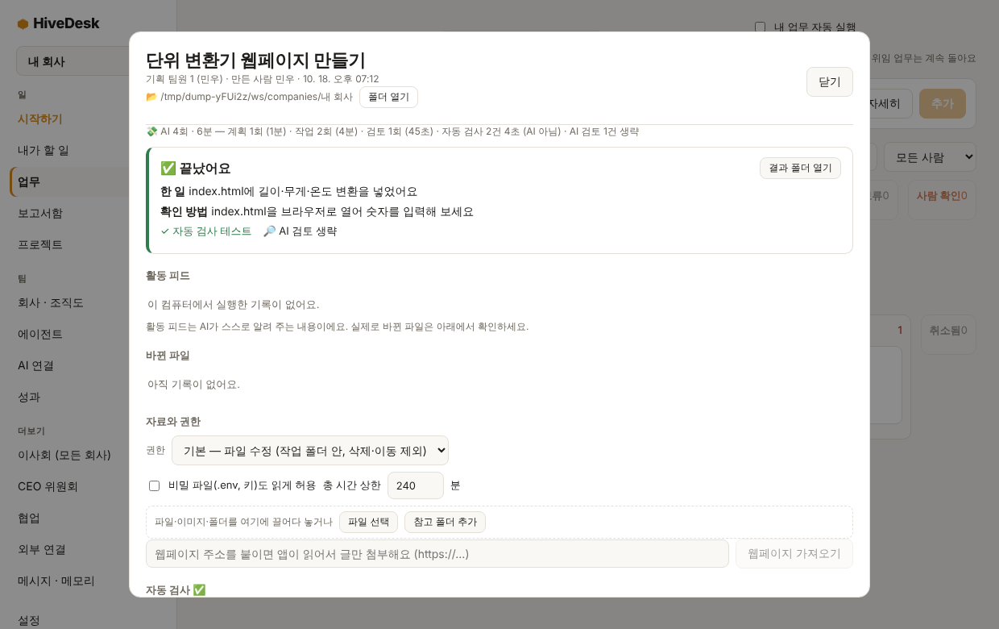
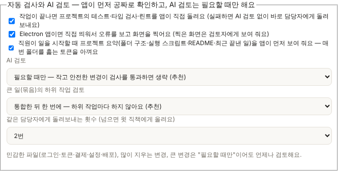

# HiveDesk 사용법 가이드

AI 직원들에게 일을 맡기고, 진행을 보고, 결과를 확인하는 앱이에요. 처음이라면 **1~4장**만 읽어도 시작할 수 있어요.

## 1. HiveDesk가 뭔가요

- **회사처럼 생각하면 쉬워요.** 내 컴퓨터에 로그인된 AI(Claude, Codex, Antigravity)가 **직원**이고, 나는 **이사회**예요. 일을 맡기면 직원이 하고, 다른 직원이 검토하고, 위험한 일만 나에게 허락을 구해요.
- **AI는 내 컴퓨터의 내 계정으로 돌아가요.** 앱이 따로 API 비용을 쓰지 않고, 각자 쓰는 구독(Claude Pro, ChatGPT Plus, Google 계정 등)의 한도 안에서 일해요.
- **용어 몇 가지** (앱 안에서는 단어 옆 **?** 를 누르면 같은 설명이 나와요)
  - **연결**: 로그인된 AI 프로그램 하나. 구독 계정 하나가 연결 하나예요.
  - **직원(에이전트)**: 연결 하나에 이름·역할·모델을 정해 둔 AI. 연결 하나로 여러 직원을 둘 수 있어요.
  - **자리**: 조직도의 한 칸(예: 서버 개발자). 직원을 앉히면 그 자리의 일을 맡아요.
  - **결재**: 위험하거나 비싼 일을 하기 전에 AI가 나에게 허락을 구하는 것.

## 2. 시작 전 준비

### 필요한 것
- 쓰고 있는 AI 구독 하나 이상: Claude Pro/Max, ChatGPT Plus/Pro, Google 계정(Antigravity, 무료 가능)
- **git**: 일을 되돌리고 변경을 비교하는 데 써요. 없으면 일부 기능(되돌리기, 줄 단위 비교)이 제한돼요.

### macOS에서 키체인 암호를 물어볼 때
외부 연결 토큰 같은 비밀값을 macOS **키체인**으로 암호화해 저장하기 때문에, 처음 쓸 때 암호를 물어볼 수 있어요.
- 넣을 암호는 **맥 로그인 암호**(컴퓨터를 켤 때 쓰는 암호)예요. 앱에는 전달되지 않아요.
- **"항상 허용"**을 누르면 다시 묻지 않아요. 앱을 업데이트한 뒤에는 한 번 더 물을 수 있어요.
- 암호가 안 맞으면 키체인 암호가 예전 맥 암호로 남아 있을 수 있어요. **키체인 접근** 앱에서 `로그인` 키체인을 골라 **편집 › 키체인 "로그인"의 암호 변경**으로 맞춰 주세요. 예전 암호를 모르면 **키체인 접근 › 설정 › 기본 키체인 재설정**을 쓰세요(저장돼 있던 암호는 다시 입력해야 할 수 있어요).
- 거부해도 앱은 돌아가요. 외부 연결 토큰 저장만 안 돼요.

## 3. 처음 10분: 첫 일 맡기기

처음 켜면 **시작하기** 화면이 열려요. 이름을 정하고 **시작하기**를 누른 뒤 세 단계를 따라가면 돼요. 세 단계를 다 하면 이 메뉴는 사라져요.

1. **쓰고 있는 AI 로그인하기**: 쓰는 AI마다 **① 설치 → ② 로그인 → ③ 연결 확인** 순서로 눌러요. 앱이 설치와 로그인 창을 열어 줘요. 하나만 연결해도 되고, 둘 이상이면 서로 검토하고 한도가 차면 이어받을 수 있어요.
2. **팀 꾸리기**: 템플릿을 고르고 **팀 꾸리기**를 누르면 조직도가 만들어지고 연결된 AI로 자리가 채워져요. 계획·검토는 강한 모델, 구현은 실속 모델, 검토자는 만든 사람과 다른 모델로 앉아요.
3. **첫 일 맡기기**: 먼저 **작업 폴더**를 고르세요(이미 만들어 둔 프로젝트 폴더를 추천해요). 고르지 않으면 앱의 회사 폴더에서 작업해요. git 폴더가 아니면 **git 폴더로 만들기**를 제안해요(변경 비교·정확한 되돌리기·동시 작업에 필요해요). 그다음 하고 싶은 일을 평소 말하듯 적고 **맡기기**를 눌러요. 누구에게 맡길지, 나눠서 할지는 앱이 정해요. 예시 문장을 누르면 입력칸에 채워져요. 맡기고 나면 **결과가 생길 폴더 열기**로 바로 열어 볼 수 있어요.

이후 **업무 › 작업 현황**에서 직원들이 지금 뭘 하는지 볼 수 있어요.

*시작하기: AI 로그인 → 팀 꾸리기 → 첫 일 맡기기*

> 처음엔 **git 폴더**에서 시작하세요. 작업할 폴더에서 `git init`을 한 번 해 두면 변경 비교와 되돌리기가 정확해져요.

## 4. 일을 잘 맡기는 법

AI는 **무엇을, 어떻게 되면 끝인지** 알면 잘해요.

좋은 예
- "단위 변환기 웹페이지를 만들어줘. index.html 하나에 길이·무게·온도 변환을 넣고, 숫자를 입력하면 바로 바뀌게. 다 만들면 README.md에 사용법을 적어줘."
- "이 폴더의 README.md를 읽고 설치 방법과 사용법을 초보자도 알 수 있게 다시 써줘."

아쉬운 예
- "앱 만들어줘" — 무슨 앱인지, 어디까지가 끝인지 몰라요.
- "알아서 잘 고쳐줘" — 뭐가 문제인지 알려 주세요.

요령
- 한 번에 **한 가지 목표**만 맡기고, 큰 일은 **끝났다고 볼 조건**을 적어요.
- 큰 일은 **조직에 맡기기**를 쓰면 관리자가 하위 업무로 나눠서 진행하고, 마지막에 최종 보고서를 올려요.
- 일하는 도중에 **추가 지시**를 보내 방향을 바꿀 수 있어요(업무 상세에서).

### 같은 폴더의 일은 왜 차례로 돌아요?
직원이 달라도 **같은 작업 폴더**에서 동시에 파일을 고치면 서로 덮어쓰기 때문에, 기본적으로 한 번에 하나씩만 돌아요. 폴더가 **git 폴더**이고 병렬 작업이 켜져 있으면 달라져요.
- 큰 일을 조직에 맡기면 하위 업무마다 폴더를 나눠서 동시에 돌아요.
- 단독으로 맡긴 일도 **같은 폴더를 쓰는 다른 일이 이미 돌고 있으면** 자기 폴더(`.hive-worktrees` 안)를 따로 받아서 동시에 돌고, 끝나면 자동으로 원래 폴더에 합쳐져요. 같은 파일을 서로 다르게 고쳤으면 합치지 않고 업무 기록에 알려 줘요(결과는 브랜치에 그대로 남아요).
- 업무 카드에 "폴더 대기"가 뜨면 이유와 해결 버튼이 같이 나와요. **git 폴더로 만들고 병렬 켜기**를 누르면 폴더에 `.git`을 만들고 지금 파일을 첫 기록으로 저장해요(설치된 패키지 폴더는 제외해요). 누르기 전에 한 번 더 물어봐요.
- 설치된 패키지(`node_modules`)는 원래 폴더 것을 연결해서 써요. 복사하지 않아요.
- 새로 시작하면 병렬 작업이 켜진 채로 시작해요. 기존 사용자는 **설정**에서 직접 켜요.
- 하위 폴더(`~/proj/server` 같은)는 git 폴더가 아니라서 병렬을 쓸 수 없어요. 프로젝트 폴더를 git의 맨 위 폴더로 지정해 주세요.

## 5. 화면 둘러보기

처음엔 **굵게 표시한 것**만 알아도 돼요. 나머지는 사이드바 아래 **고급 메뉴 보기**를 켜면 나와요.

**일**
- **시작하기**: 위 3단계(다 하면 사라짐)
- **내가 할 일**: 결재, AI의 질문, 확인할 결과, 실패한 일 등 내가 해야 하는 것이 모여요. 숫자 배지가 붙어요.
- **챗**: AI와 바로 대화해요. 위에서 모델(Haiku·Sonnet·Opus 등)을 고르고 물어보세요. 챗은 파일을 바꾸지 않고(읽기 전용), 대화는 이 컴퓨터에만 저장돼요. 한도에 걸리면 다른 모델로 이어서 보낼지 물어요. 파일을 바꿔야 하면 **업무**로 맡기세요.
- **업무**: 맡긴 일과 진행 상황. 오른쪽 위 스위치로 **오피스**(직원 모습) · **작업 현황**(말풍선과 진행 막대) · **목록**(상태별 카드)을 바꿔 봐요.
- **보고서함**: 큰 일이 끝났을 때의 최종 보고서
- **프로젝트**: 작업 폴더와 프로젝트 설명(모든 직원이 일하기 전에 읽어요). 브리핑 위의 **시작 규칙 불러오기**에서 Electron 앱·웹 페이지·파이썬 프로그램용 규칙을 채울 수 있어요. Electron 폴더로 첫 일을 맡기면 자동으로 들어가요.

**팀**
- **회사 · 조직도**: 조직도, 팀 꾸리기, 저장한 팀, 다른 회사 직원 데려오기
- **에이전트**: 직원 한 명 한 명의 설정(모델, 작업 폴더, 한도 등)
- **AI 연결**: 로그인 상태와 모델 목록. 아래 **내 PC AI**에서 Ollama·LM Studio 같은 로컬 AI를 연결하고(키 없음, 구독 한도 안 씀), 속도를 재서 이 PC에 맞는 등급을 확인하고, Ollama 모델을 설치·업데이트·지울 수 있어요. 연결한 모델은 챗에서 `내 PC`로 나와요. 설치할 모델 목록에는 태그(코딩·경량·이 PC에 잘 맞아요 등)가 붙고, 필터 칩과 정렬로 좁힐 수 있어요. `추천`은 이 PC에서 직접 실측을 통과한 모델에만 붙어요. 설치 전에는 모델의 라이선스 조건을 직접 확인해야 해요.
- 성과(고급): 직원별 성과

**더보기(고급)**: 이사회(모든 회사), CEO 위원회, 협업, 외부 연결, 메시지 · 메모리. 기다리는 일이 있으면 기본 모드에서도 나타나요.

**설정**: 이름, 작업 공간, 자동 실행, 알림, 한도 이어받기, 자동 검사와 AI 검토 등

*업무 › 작업 현황: 일하는 직원의 말풍선과 오른쪽 진행 막대*

*회사 · 조직도: 팀 꾸리기, 저장한 팀, 자리와 직원*

## 6. 결재와 질문에 답하기

**내가 할 일**에서 처리해요.
- **결재**: AI가 파일을 지우거나 명령을 실행하는 등 허락이 필요한 일을 할 때 떠요. 이유를 읽고 **승인**하거나 **거절**하세요. 권한을 올려서 이어가는 선택지도 있어요.
- **자료를 기다려요**: AI가 파일이나 정보를 요청한 거예요. 답하거나 파일을 넣어 주면 같은 대화를 이어서 해요.
- **결과를 확인해 주세요**: 파일을 바꾼 일은 내가 확인해야 끝으로 처리돼요(설정의 사람 확인 규칙에 따라 달라요).
- **다른 화면에서 기다리는 일**: 실패한 업무, 최종 보고서, 위원회 안건, 협업 요청, 한도 대기, 다시 로그인이 필요한 AI. **보러 가기**로 이동해요.

자동 실행을 쓰려면 **내 업무 자동 실행**(내가 만든 업무)과 **조직 자동 진행**(조직에 맡긴 업무)을 켜 두세요. 꺼져 있으면 **이어서 하기**나 실행 버튼을 직접 눌러야 시작해요.

*내가 할 일: 다른 화면에서 기다리는 일과 결재*

## 7. 결과 확인과 되돌리기

끝난 업무를 열면(**업무 › 목록**에서 **기록·변경**) 맨 위에 **결과 카드**가 나와요.
- **한 일 / 확인 방법**: AI의 보고
- **바뀐 파일**, **자동 검사**, **검토 결과**, **남은 위험**
- **결과 폴더 열기**, (Electron 앱이면) **앱 화면 보기**

**자동 검사**는 AI를 쓰지 않고 앱이 직접 하는 확인이에요. 프로젝트의 테스트·타입 검사·린트를 돌리고, Electron 앱이면 띄워서 오류와 첫 화면을 확인해요. 실패하면 AI 검토 없이 오류 내용과 함께 담당자에게 바로 돌려보내요. 작고 안전한 변경이 검사를 통과하면 AI 검토를 생략해요(설정 › 자동 검사와 AI 검토에서 바꿔요).

*끝난 업무의 결과 카드: 한 일, 확인 방법, 자동 검사, 검토 결과, AI 실행 횟수와 시간*

*설정 › 자동 검사와 AI 검토*

**AI 실행 횟수와 시간**: 업무 상세 위쪽 한 줄에 계획·작업·다시 작업·검토·통합이 각각 몇 번, 얼마나 걸렸는지, 자동 검사 시간(AI 아님), 생략한 AI 검토 수가 나와요. 어디서 시간과 한도가 나가는지 보고 설정을 조절하세요.

**토큰을 아끼는 장치** (설정 › 자동 검사와 AI 검토)
- **프로젝트 요약**: 직원이 일을 시작할 때 폴더 구조, 실행 스크립트, README, 최근 끝낸 일을 앱이 먼저 보여 줘서 매번 폴더를 훑지 않아요.
- **큰 일(묶음)의 하위 작업 검토**: 기본은 하위 작업마다 검토하지 않고, 통합한 뒤 **한 번에** 교차 검토해요. 검토 의견은 최종 보고서의 남은 위험에 적혀요. 로그인·토큰·결제 같은 민감한 변경은 그래도 따로 검토해요.

**마음에 안 들면**: 같은 화면의 **이 실행 되돌리기**로 작업 폴더를 그 실행 전 상태로 돌려요. git 폴더면 정확하게 돌아가고, 아니면 백업한 파일로 복원해요. 되돌린 뒤 **추가 지시**로 다시 시킬 수 있어요.

## 8. 한도와 이어받기

구독마다 일정 시간 동안 쓸 수 있는 양이 정해져 있어요. 다 쓰면 풀릴 때까지 그 연결은 쉬어요.

- **이어받기**: 한도가 차면 다른 연결의 직원이 **마지막으로 끝낸 단계부터** 이어서 해요. 일하던 중간 단계는 시작 상태로 되돌리고, 요약을 넘겨받아요.
- **같은 연결의 직원은 같은 한도를 써요.** 그래서 이어받는 직원은 항상 다른 연결에서 골라요.
- **물어보는 경우**: 이어받는 쪽의 사용량이 2배 이상 늘면 **내가 할 일**에서 먼저 물어봐요.
- **기다리는 경우**: 한도가 20분 안에 풀린다고 알려졌으면 넘기지 않고 기다려요.
- **직접 넘기기**: 업무 상세의 **담당 넘기기 › 다른 직원에게 넘기기**
- 끄거나 바꾸려면 **설정 › 한도 이어받기**. 한도처럼 보이지만 알아보지 못한 실패는 같은 곳에 쌓여요.

## 9. 구독별 추천 구성

| 연결 | 성격 | 추천 역할 |
|---|---|---|
| Claude Pro | 품질 좋음, 한도 빡빡함 | 계획, 어려운 구현, 최종 검토 |
| ChatGPT Plus (Codex) | 한도가 비교적 넉넉함 | 주력 구현, 테스트 작성 |
| Antigravity (무료) | 한도가 적고 들쭉날쭉함 | 문서, 간단한 수정, 보조 |

**팀 꾸리기**가 이 조합에 맞춰 자동으로 앉혀 줘요. 규칙: 검토는 만든 모델과 **다른 모델**이 해요. 계획·통합 같은 관리자 일은 관리자 직원만 받아요.

한 번 만든 팀은 **회사 · 조직도 › 지금 팀 저장**으로 저장하고, 다른 회사에서 **이 회사에 꾸리기**로 불러와요. 다른 회사의 직원을 **데려오기**로 복사할 수도 있어요(작업 폴더는 복사하지 않아요).

## 한 폴더 모드 (선택)

기본은 예전과 똑같아요. 설정 화면에서 **한 폴더 모드**를 켜고 폴더를 고르면, 다음 실행부터 설정(`config.json` 등)은 `<폴더>/data`, 임시 파일은 `<폴더>/tmp`에 모여요.

- 켤 때 설정 파일은 **복사**돼요(이동 아님). 복사가 확인된 뒤에만 새 위치를 쓰고, 옛 파일은 지우지 않아요. 안내에 옛 위치가 나와요.
- 회사 데이터는 옮기지 않아요. 작업공간 폴더 설정을 그대로 따라요. 한곳에 두고 싶으면 작업공간 폴더를 같은 폴더로 직접 정해 주세요.
- 폴더 밖에 한 개가 남아요: 앱 데이터 폴더의 `HiveDesk-bootstrap.json`(모드와 위치를 적은 작은 파일). 끄려면 설정에서 끄고 이 파일을 지워도 돼요.
- 폴더 밖에 남는 것: Claude·Codex·Antigravity 로그인 정보(각 프로그램이 관리), OS 보안 저장소의 암호화 키(토큰 자체는 폴더 안), 프로젝트 옆 병렬 작업 폴더(`.hive-worktrees`), 앱 본체.

## 휴대용 버전 (선택)

설치 없이 폴더째 들고 다니는 버전이에요. 데이터는 앱 옆의 `HiveDesk-data/`에만 쌓이고, 시스템 앱 데이터 폴더에는 아무것도 만들지 않아요(`HiveDesk-bootstrap.json`도 만들지 않아요). 폴더를 옮기거나 지우면 끝이에요.

- **Windows**: 릴리스의 `HiveDesk-Portable-<버전>.exe`를 원하는 폴더에서 실행해요. 그 exe 옆에 `HiveDesk-data/`가 생겨요. 실행할 때마다 임시 폴더에 풀리는 방식이라(electron-builder portable 타깃) 첫 실행이 느릴 수 있어요. 설치용 exe와 같은 앱이라 기능은 같아요.
- **macOS**: `.zip`(이름은 `HiveDesk-<버전>-arm64-mac.zip` 또는 `HiveDesk-<버전>-mac.zip`이고, dmg와 달리 압축 파일이에요)을 폴더에 풀어요. 압축 안에 `HiveDesk.app`과 `portable.flag`가 같이 들어 있고, 둘을 같은 폴더에 두면 그 옆에 `HiveDesk-data/`가 생겨요. `.app`만 따로 꺼내 쓰려면 `.app` 옆에 `portable.flag` 파일(빈 파일이면 돼요) 또는 `HiveDesk-data` 폴더를 직접 만들어 주세요. 다운로드 폴더에서 바로 열면 macOS가 앱을 임시 위치로 옮겨 실행할 수 있으니(확인 필요) 먼저 폴더로 옮겨 주세요.
- **판정 규칙**: Windows portable exe가 설정하는 환경변수 `PORTABLE_EXECUTABLE_DIR`가 있으면 그 폴더, 아니면 앱(맥은 `.app`) 옆에 `portable.flag` 또는 `HiveDesk-data`가 있으면 휴대용이에요. 설정 화면의 한 폴더 모드는 항상 켜진 채 잠기고 "휴대용 모드예요: 데이터는 …에만 있어요"가 보여요.
- **읽기 전용 USB**: 그 폴더에 쓸 수 없으면 안내를 띄우고 이번에는 일반 모드로 시작해요(데이터는 이 컴퓨터의 앱 데이터 폴더).
- **폴더 밖에 남는 것**: Claude·Codex·Antigravity 로그인 정보(각 프로그램이 관리), OS 보안 저장소의 암호화 키, 프로젝트 옆 병렬 작업 폴더(`.hive-worktrees`).
- **다른 컴퓨터로 옮기면** 연결 토큰은 폴더 안에 있어도 암호화 키가 그 컴퓨터에 있어 풀리지 않으니 다시 입력해야 해요. CLI 로그인도 새 컴퓨터에서 다시 해야 해요.
- 코드 서명이 없어서 처음 열 때 맥은 "그래도 열기", 윈도우는 SmartScreen 안내가 나올 수 있어요.

## Ollama를 HiveDesk 폴더에 설치하기 (선택)

**내 PC AI** 화면의 "HiveDesk 전용 Ollama"에서 **설치하기**를 누르면, 설치 프로그램 없이 Ollama 실행 파일을 HiveDesk 폴더에 직접 받아요. 켜고 끄는 것도 이 화면에서 해요.

- 폴더 구조: 프로그램은 `<HiveDesk 폴더>/engine/ollama/<버전>/`, 모델은 `<HiveDesk 폴더>/models`예요. 한 폴더 모드를 켰다면 그 폴더, 아니면 `~/HiveDesk`를 써요. 이미 있는 `~/.ollama`(직접 설치한 Ollama의 모델)는 건드리지 않아요.
- 받는 곳: GitHub 릴리스(`ollama-darwin.tgz`, `ollama-windows-amd64.zip`)만 허용해요. 받은 파일의 **sha256이 맞을 때만** 풀고 실행해요. 안 맞거나 값이 없으면 설치를 거부하고 이유를 보여줘요.
- 용량: 맥은 약 175MB, 윈도우(x64)는 약 1.5GB예요(GPU 라이브러리 포함). 중지하면 받은 데까지 이어받아요.
- 맥: 유니버설 바이너리 하나로 인텔·Apple 칩을 모두 지원해요. 처음 실행할 때 macOS 보안 경고가 뜨거나 실행이 막히면, 그때 나오는 실제 메시지를 화면에 그대로 보여줘요.
- 윈도우: zip을 앱이 직접 풀어요(PowerShell 불필요). 백신이 새 실행 파일을 검사하느라 느려지거나 오탐할 수 있어요. 지원은 x64만 확인했어요. ARM·리눅스는 아직 확인 전이라 버튼이 꺼져 있어요.
- 포트: 기본 11434를 이미 다른 Ollama가 쓰고 있으면 11435부터 빈 포트를 골라 켜고, 화면에 알려줘요. 켜지면 "HiveDesk Ollama" 연결이 자동으로 생겨요(중복 없음).
- 지우기: **엔진 지우기**는 프로그램만 지워요. 모델은 남으니, 개별 삭제는 모델 옆 **지우기**를 쓰거나 `models` 폴더를 직접 지워 주세요. 앱을 끄면 켜 둔 Ollama도 함께 꺼져요.
- 다운로드 정보(버전·주소·sha256)는 코드가 아니라 `src/shared/ollama-engine.default.json` 데이터 파일이에요. 새 버전은 이 파일의 값을 검증해서 바꿔요.

## 내 PC AI로 일 맡기기 (선택)

**에이전트 → + 에이전트 추가 → 사용할 AI: 내 PC AI**에서 이 컴퓨터의 모델(Ollama·LM Studio 등)을 직원으로 쓸 수 있어요. 먼저 **AI 연결** 화면에서 내 PC AI를 연결해 두세요. 사용량 한도가 없고 돈이 들지 않지만, 작은 모델(3~8B급)이라 **쉬운 일만** 맡아요.

- **어떤 일을 하나요**: 파일 3개 이하·글자 합계 24,000자 이하의 작은 수정(버그 한 곳 고치기, 함수 하나 만들기, 이름 바꾸기 등)이에요. 고칠 파일은 업무에 적힌 경로로 정하고, 경로가 없으면 앱이 키워드로 찾아요. 모델은 도구를 직접 쓰지 않아요. 앱이 파일을 주고, 모델이 고친 파일 전체를 돌려주면 앱이 적용해요.
- **어떻게 확인하나요**: 적용 전에 상태를 저장하고(되돌리기에 쓰는 그 체크포인트), 적용 뒤 프로젝트의 자동 검사(테스트·타입 검사)를 돌려요. 실패하면 오류를 붙여 같은 모델에게 최대 2번 더 시켜요.
- **사람에게 되돌아오는 경우** (업무가 "질문 있음" 상태가 되고 이유가 적혀요):
  - 파일이 3개를 넘거나 24,000자를 넘거나, 어느 파일인지 정하지 못할 때: "이 일은 내 PC AI에 맡기기엔 커요". 파일 경로를 적어 답하면 다시 해 봐요.
  - 3번 시도해도 자동 검사를 통과하지 못할 때: 고친 내용을 모두 되돌리고, 시도 횟수와 마지막 오류를 알려줘요. 외부 모델로 자동으로 넘기지는 않아요.
  - 모델이 `.env`·키 파일·`.git`이나 작업 폴더 밖을 고치려 할 때, 보여 주지 않은 기존 파일을 덮어쓰려 할 때: 아무것도 적용하지 않아요.
  - "읽기만" 권한인 업무.
- **결과를 꼭 사람이 보는 경우**: 폴더에 자동 검사가 하나도 없으면 실행은 하되 결과를 "확인 대기"로 보내요.
- **멈추거나 응답이 없을 때**: 중지·취소하면 고친 파일을 원래대로 돌려요. 모델이 아무 말이 없거나 연결이 끊기면 업무가 실패로 표시돼요(무응답 제한은 에이전트의 무응답 제한 분을 따라요).
- **알아 두세요**: 모델이 8GB 맥·6GB GPU에 비해 크면 에이전트 설정에서 경고가 떠요. 실측(AI 연결 화면의 "실측(10개)" → "결과 보기")에서 통과·실패 항목과 이유를 볼 수 있어요. 자동 배정에는 내 PC AI 직원이 들어가지 않아요(직접 배정한 업무만 해요). 한도 이어받기에는 아래 조건을 모두 채울 때만 들어가요.
- **같은 모델을 여럿이 쓸 때(대기열)**: 같은 연결·같은 모델은 한 번에 업무 하나만 돌아요. 나머지는 차례를 기다리고, 작업 현황에 "로컬 대기 중 (2번째)"로 보여요. 중지·취소하면 줄에서 빠져요. 20분을 넘게 기다리면 시작하지 않고 사람(또는 다른 직원)에게 넘겨요. **챗과의 규칙**: 같은 모델을 업무가 쓰거나 기다리는 중이면 챗은 "이 모델을 업무가 쓰고 있어요"라며 보내지지 않아요. 챗이 답을 쓰는 중이면 업무가 그동안 기다려요.
- **PC 문제로 못 할 때**: 메모리 부족·모델 불러오기 실패는 다시 시도하지 않고(같은 일이 되풀이돼요) 업무 기록에 "오류 분류: PC 메모리 부족"처럼 한 줄 남긴 뒤 사람에게 넘겨요. 쓸 수 있는 다른 직원이 있고 설정이 허용하면 그 직원이 이어받아요. 연결이 끊긴 경우만 최대 2번 다시 연결해 봐요. 시간 초과는 다시 시도하지 않고 실패로 표시해요.
- **한도 때문에 내 PC AI가 이어받기**: 외부 AI의 구독 한도가 차면, 다른 외부 직원이 없을 때 내 PC AI 직원이 이어받아요(설정 → 한도 이어받기의 체크박스로 끌 수 있어요). 쉬운 일(위 범위)이어야 하고, "읽기만"이 아니어야 하고, 모델이 떠 있어야 하고, 대기열에 이미 2개 넘게 줄 서 있지 않아야 해요. 하나라도 안 맞으면 억지로 넘기지 않고 원래대로 한도가 풀리길 기다리거나 사람이 정해요. 넘긴 이유는 "구독 한도 / PC 메모리 부족 / 로컬 대기열"로 업무 기록에 남아요.
- **예시 모으기(선택, 기본 꺼짐)**: 설정에서 켜면 내 PC AI가 한 일을 회사 폴더의 `.local/examples/날짜.jsonl`에 한 줄씩 저장해요(요청·준 파일·받은 수정본·검사 결과·시도 횟수·사람 승인 여부). 키·토큰·비밀번호처럼 보이는 글자는 `***`로 바꿔요. 이 컴퓨터 밖으로 보내지 않고, 지금은 학습도 하지 않아요. 나중에 모델을 다듬을 때 쓸 준비일 뿐이에요. 결과를 사람이 승인하면 그 줄의 승인 여부가 true로 바뀌어요.

## 10. 자주 묻는 질문 / 문제 해결

**일이 시작되지 않아요**
- **내 업무 자동 실행**이 꺼져 있으면 업무 카드의 실행 버튼을 눌러야 해요.
- 담당 직원의 연결이 로그인이 풀렸을 수 있어요. **AI 연결** 또는 **시작하기**에서 **② 로그인 → ③ 연결 확인**을 다시 하세요.
- 같은 폴더에서 다른 업무가 돌고 있으면 순서를 기다려요.

**"연결 확인"이 실패해요**
- 설치됐는지(**① 설치**), 로그인됐는지(**② 로그인**)를 차례로 확인하세요. 로그인 창에서 인증을 마쳐야 해요.

**한도가 찼다고 나와요**
- 8장을 보세요. 다른 연결이 있으면 자동으로 이어받고, 없으면 풀릴 때까지 기다려요.

**자동 검사가 계속 실패해요**
- 업무 상세의 **자동 검사**에서 실패한 항목을 눌러 출력을 보세요. 원래 깨져 있던 테스트라면 같은 실패가 반복될 때 검토자가 판단해요.
- 프로젝트에 `node_modules`가 없으면 검사는 "패키지가 설치되지 않아서" 건너뛰어요. 폴더에서 `npm install`을 한 번 해 주세요.
- 검사를 끄려면 **설정 › 자동 검사와 AI 검토**.

**실수로 파일이 바뀌었어요**
- 7장의 **이 실행 되돌리기**를 쓰세요.

**화면 안내를 다시 보고 싶어요**
- **설정 › 도움말 › 화면 안내 다시 보기**. 같은 곳의 **용어 풀이**에 모든 용어 설명이 있어요.

**메뉴가 너무 많아 보여요 / 메뉴가 없어요**
- 사이드바 아래 **고급 메뉴 보기**로 전환해요.

**macOS 키체인 암호를 물어봐요**
- 2장을 보세요.
